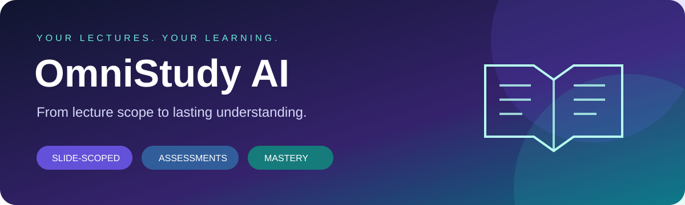

# OmniStudy AI



> A slide-scoped study workspace that turns lecture material into focused notes, timed assessments, feedback, and a living wrong-question bank.

[](https://www.python.org/)
[](https://fastapi.tiangolo.com/)
[](https://react.dev/)
[](https://vitejs.dev/)

OmniStudy AI is a full-stack academic workspace for courses such as quantitative finance, mathematics, data science, and pharmaceutical sciences. Lecture slides define the scope. Supplementary material can clarify that scope, while generated notes and assessments stay grounded in the selected slides.

## What it does

- **Slide-scoped RAG:** extracts PPTX, PDF, and Markdown slide content and uses it as the primary knowledge boundary.
- **Study guides:** creates structured notes with definitions, formulas, worked examples, and exam pitfalls.
- **Timed assessment modes:** section quizzes, chapter mock tests, and midterm/final-length exams with five-option MCQs, short answers, and calculations.
- **Handwritten work:** accepts pasted screenshots or camera photos for OCR and rubric-based feedback.
- **Wrong-question bank:** records missed concepts, generates isomorphic practice questions, and graduates a concept after three consecutive correct attempts.
- **Voice tutor:** combines local Faster-Whisper transcription with Edge TTS playback and an interruption shortcut.
- **Hybrid model routing:** routes requests through University of Macau GenAI, direct DeepSeek, and local Ollama. OpenAI-related settings are present, but a direct OpenAI client is not yet implemented.
- **Academic exports:** downloads Markdown and LaTeX, and opens print-ready HTML for browser **Print → Save as PDF**.

## Repository layout

```text
omni-study-ai/
├── backend/
│   ├── main.py                 # FastAPI entrypoint and health endpoint
│   ├── config.py               # Environment-backed settings
│   ├── database.py             # SQLite setup and session dependency
│   ├── models.py               # SQLAlchemy models
│   ├── requirements.txt        # Python runtime and test dependencies
│   ├── routers/                # Upload, assessment, voice, export, and settings APIs
│   ├── services/               # RAG, model routing, scoring, OCR, and export logic
│   └── storage/                # Runtime-only uploads, database, and generated files
├── frontend/
│   ├── src/                    # React application and feature components
│   ├── package.json            # Frontend scripts and dependencies
│   └── vite.config.ts          # Vite development configuration
├── docs/assets/                # Repository artwork
├── requirements.txt            # Root install entrypoint
├── .env.example                # Safe configuration template
├── setup_mac.sh                # macOS setup helper
└── README.md
```

Runtime data stays under `backend/storage/` and is intentionally ignored by Git. Add your own lecture files through the UI after setup; sample PDFs, databases, browser profiles, logs, and compiled frontend output are not part of this repository.

## Quick start

### 1. Configure the backend

```bash
python3.11 -m venv .venv
source .venv/bin/activate
python -m pip install --upgrade pip
python -m pip install -r backend/requirements.txt
python -m playwright install chromium
cp .env.example .env
```

Open `.env` and add only the provider credentials you choose. The app can run with a local Ollama model, direct DeepSeek, or University of Macau GenAI when reachable. Model names in the template are application defaults; select models available from your provider. UMPASS username, password, browser cookies, and JWT/cookie tokens are optional local credentials and must stay on your machine.

### 2. Install the frontend

```bash
npm --prefix frontend install
```

### 3. Run both services

```bash
# Terminal 1
source .venv/bin/activate
python -m uvicorn main:app --app-dir backend --reload --host 127.0.0.1 --port 8000

# Terminal 2
npm --prefix frontend run dev
```

Open `http://localhost:5173`. The API health endpoint and Swagger UI are available at `http://127.0.0.1:8000/api/health` and `http://127.0.0.1:8000/docs`.

For a guided macOS setup, run `./setup_mac.sh`. It creates a local virtual environment, installs backend and frontend dependencies, installs the Playwright browser, and creates `.env` from `.env.example` when needed.

## Configuration guide

| Variable group | Purpose | Required? |
| --- | --- | --- |
| `OPEN_WEBUI_*` | University of Macau GenAI / Open WebUI endpoint and models | No |
| `DEEPSEEK_*` | Direct DeepSeek fallback | No |
| `OPENAI_*` | Reserved configuration; direct routing not implemented | No |
| `OLLAMA_*` | Local model fallback | No |
| `UMPASS_USERNAME`, `UMPASS_PASSWORD` | Optional campus SSO recovery | No |
| Study rule variables | Mastery threshold, streak length, exam duration | No; defaults are provided |

At least one model route must be configured for AI-generated notes and assessments. Settings can also be entered through the in-app settings panel; values are written to the local `.env` file only.

## Safety and privacy

- `.env`, local databases, uploads, logs, browser profiles, and generated build artifacts are ignored by Git.
- Do not commit API keys, UMPASS credentials, JWT bearer tokens, cookie values, or copied browser profile files.
- If a secret was ever exposed, revoke or rotate it at the provider before continuing.
- Review `SECURITY.md` before sharing a fork or opening an issue that contains logs.

## Useful shortcuts

| Shortcut | Action |
| --- | --- |
| `Cmd + ,` | Open model routing and UMPASS settings |
| `Cmd + V` | Paste a handwritten solution image into an answer field |
| `Space` | Interrupt the voice tutor |
| `Cmd + Shift + R` | Hard-refresh the frontend bundle |

## Development checks

```bash
source .venv/bin/activate
python backend/test_scoring.py
# Optional integration demo: calls your configured AI provider and writes test data
python backend/test_rag_and_vision.py
npm --prefix frontend run build
```

The scoring script writes sample records to your local database. Run demos in a disposable checkout. AI integration demos require a configured provider and can incur usage charges.

## Explore

[Backend guide](backend/README.md) · [Frontend guide](frontend/README.md) · [Security and local data](SECURITY.md)

This is a personal local study tool. Keep the backend on loopback: settings endpoints expose local credentials, and `/storage` serves runtime files. Do not expose it to a public network. Scope constraints guide the model; review generated notes and grades for accuracy.

## License

No license has been selected yet. Add a license file before redistributing the project.
